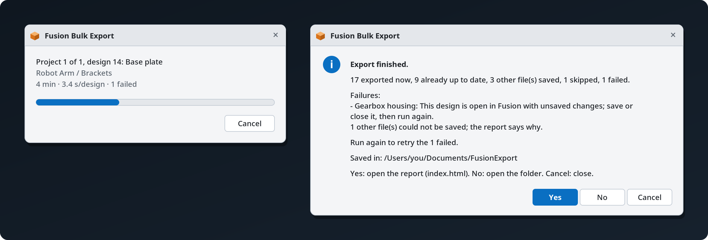

# Fusion Bulk Export


Get all of your Fusion designs out, in one go.

- Saves every design in every hub, project and folder you can access as a Fusion archive (`.f3d`) plus a `.step`, under their real names, in the same project and folder layout.
- Saves the other files too: PDFs, images and uploaded files as they are.
- Resumable: run it again on the same folder and it skips what's already done.
- Everything stays on your computer. Nothing in your account is changed.

**Tested on real Fusion** (2706.1.17) on macOS and Windows 11 with real accounts, through the toolbar button and the command line: a whole account of 59 designs exported with no failures in under 3 minutes, every archive and STEP file checked; single folders, resuming, cancelling and long paths were checked too. Users have reported whole-account runs of 120, 959 and about 1,500 designs with no failures on 0.3 versions (see [Discussions](../../discussions)); we have not measured a run that large ourselves. If you hit a problem, please [open an issue](../../issues/new/choose); if it worked, [tell us how it went](../../discussions/new?category=show-and-tell).

## Quick start

You need Fusion installed and signed in, on macOS or Windows. Nothing else.

**Step 1: Download**
1. Open the [latest release](../../releases/latest).
2. Under **Assets**, click `FusionBulkExport-<version>.zip`.
3. Unzip it. You get a folder named `FusionBulkExport-<version>` with two installers, a `README.txt` and the add-in.

**Step 2: Install and switch it on (once)**
1. In the unzipped folder, double-click the installer for your computer:
   - **macOS:** `Install (macOS).command`. It is not signed, so the first time macOS (Gatekeeper) refuses to open it: right-click it, choose **Open**, then **Open** again. If there is no **Open** button, open **System Settings → Privacy & Security**, scroll down and click **Open Anyway**.
   - **Windows:** `Install (Windows).bat`. If SmartScreen warns you, click **More info**, then **Run anyway**.

   It copies the add-in into Fusion's add-ins folder and changes nothing else. You can delete the download afterwards.
2. In Fusion press **Shift+S** (**Utilities → Add-Ins → Scripts and Add-Ins**). Find **FusionBulkExport** in the list: type its name in **Search**, or tick **Add-ins** under **Type** on the left.
3. Tick its **Run on Startup** box first, then switch **Run** on, so it is there every time Fusion starts. The window closes when you switch it on; that is normal.

If **FusionBulkExport** is not in the list, or you would rather not run the installer: move the `FusionBulkExport` folder from the download somewhere it can stay (Documents is fine), click the **+** at the top of the list and choose the add-in's folder, then tick **Run on Startup** and switch **Run** on as above.

**Step 3: Export**
1. Open the **Utilities** tab and click the orange cube in the **ADD-INS** group (**Fusion Bulk Export**).
2. Check **Save to**. The first time it suggests `Documents/FusionExport`; **Browse…** picks another folder, and the dialog remembers your choice. If the folder already holds an export, the line under it says **Continues the export in this folder**.
3. Choose what to export:
   - **Everything**: every design in every hub and project you can see.
   - **Choose projects or folders**: a tree of your hubs, projects and folders. Click a row to open it, tick a box to include it. A ticked folder includes everything inside it.
4. Leave **Also save other files (PDFs, uploads)** ticked to save them too, or untick it for designs only. The choice is remembered.
5. Click **Export** and wait for the results at the end: the counts, the first failures and the output folder, with **Open report** (`index.html`) and **Open folder**; **Close** closes it.

**Fusion can't be used while it exports.** Leave it open and signed in until the summary appears; the computer is kept awake meanwhile. **Cancel** is safe: what is finished stays finished. Run it again on the same folder to continue, to retry failures, or to pick up designs added later.

*The pictures below are illustrations drawn from made-up names, not screenshots of a real account.*




### The dialog

- The first line shows the version that is running.
- **Choose projects or folders** opens a tree. Type in the filter box to narrow the projects by name. The keyboard works too: arrow keys move and open, **Space** ticks, **Enter** opens. An opened project or folder shows how many files it holds, and a project that already has files in the chosen folder is marked "N exported".
- A name too long for its row ends in "…": hover over the row to read it whole.
- If a folder cannot be listed, the tree says so with a **Retry** button.
- The button is always there, also after an export from the command line. Only one export runs at a time.
- **Also save a STEP file for each design** is ticked by default (remembered). Keep it: a STEP opens in almost any CAD program, while the `.f3d` opens only in Fusion. It costs time: in our tests a design took about twice as long with its STEP as without. Unticked, each design is saved as `.f3d` only, and the dialog says so ("Without STEP you get only .f3d files, which open only in Fusion."). Exporting into the same folder later with it ticked adds the missing STEP files.
- **Keep only each design's newest version** is off by default (remembered). Ticked, the dialog says "Older versions of a design are removed from this folder after its newest version is saved." See "A single, current export" under [What you get](#what-you-get) for exactly what is removed.
- The dialog reads top to bottom: **Save to**, the STEP box, the other-files box, the **Export** choice, then the tree, so every control is in view when it opens; the tree scrolls inside itself.
- On Windows the output folder's own path can be at most 200 characters (the files below it may be longer). A longer one is refused, with the reason under **Save to**; choose a shorter folder such as `C:\FusionExport`.
- While it exports, the progress text says which design (or "file N" for another file) it is on, before Fusion starts on it: if Fusion stalls, you can see on which item.
- If the run gets into trouble (5 designs failing in a row, a full disk, the output folder gone), it pauses, shows the reason and the last error, and asks "Try again now?": **OK** carries on, **Cancel** stops. Everything exported so far is kept either way.
- The results at the end, in a dialog with **Open report** and **Open folder** and one **Close** button: a headline (Finished, Cancelled, or Stopped with the reason), the counts (rows that are zero are left out), up to three failures by name with "and N more in the report", "Run again to retry the N failed" when something failed, notes (files Fusion's export does not support, slow items, low disk space, long Windows paths), and the output folder, which can be selected. If a button gets no answer from Fusion within 2 seconds, the page shows the path with **Copy**. If Fusion cannot open the dialog at all, the same summary comes in a message with **OK** (with the paths of the folder and of `index.html`), and `results-fallback.log` beside the add-in says why.

### Big account? Go one project at a time

If you have hundreds or thousands of designs, start small:

1. Pick **Choose projects or folders** and tick **one** project or folder.
2. Export it and look at the result: open `index.html` in the output folder, open a couple of the `.f3d` files in Fusion and check the counts in the summary.
3. Then do the next project, or the rest, into **the same output folder**. Finished designs are checked and skipped, so nothing is done twice.

What to expect: the export starts right away and works folder by folder: it lists a folder, exports what it finds, then moves on, so the first files appear within seconds. The progress dialog shows the project, folder and design it is on, how long it has been running, the average time per design and how many failed. So far a design has taken between 3 and 9 seconds depending on the account, so 1,000 designs is roughly one to two and a half hours. **Your time will vary**: large assemblies, many bodies and heavy history take much longer than simple parts, and listing a large project is slow in Fusion itself, so treat these numbers as a rough guide and time your first project.

Long runs can make Fusion use more and more memory. The export watches Fusion's own memory, not how full the computer is: only when Fusion itself holds over 70% of the computer's memory, or has grown by over 4 GB while the computer is short of memory, and that lasts (at least 5 designs and 30 seconds, never before the 25th), does it stop itself and say "Stopped: Fusion is using a lot of memory": close Fusion, open it again and run the export on the same folder, and it carries on where it stopped. The command line can do that by itself with `autorun.py export OUT --restart-fusion`, which closes and reopens Fusion when nothing else is open in it. When other programs use up the memory instead, the export goes on, and if the computer stays critically short of memory for a while (macOS's "critical" memory pressure, not its everyday "warning"; on Windows, little commit and physical memory left), the report notes that closing other programs may speed it up.

To switch this memory stop off, set `FUSION_BULK_EXPORT_MEMORY_GUARD=off` in the environment of `autorun.py` (or of Fusion), or add `"memory_guard": false` to the add-in's `settings.json` (`~/Library/Application Support/FusionBulkExport/` on macOS, `%APPDATA%\FusionBulkExport\` on Windows).

**Let your AI do it.** If you use an AI agent that can run commands on your computer, paste this into it:

```text
Back up my Autodesk Fusion designs to this computer with Fusion Bulk Export
(https://github.com/cad-lifeboat/fusion-bulk-export). Download the repository and follow its AGENTS.md.
- Start with an inventory and tell me only the counts (hubs, projects, designs).
- If I have hundreds of designs or more, go one project at a time into the same output folder,
  and check each one before the next.
- Never print or repeat my project or design names, never upload, change or delete anything in my
  Fusion account, and ask me before deleting anything on disk.
- Tell me when you need me to sign in or click something in Fusion.
```

It only needs you for signing in and, the first time, switching the add-in on in Fusion.

## What you get

```
FusionExport/
  My Hub/Robot Arm/Brackets/Base plate v3.f3d     the full design: history, sketches, everything
  My Hub/Robot Arm/Brackets/Base plate v3.step    geometry for any other CAD program
  My Hub/Robot Arm/Brackets/Base plate v3.png     the design's thumbnail
  My Hub/Robot Arm/Arm assembly v7.f3d            an assembly: its own bodies and its links to the linked designs
  My Hub/Robot Arm/Brackets/Datasheet.pdf         another file, under its own name
  index.html                                      the report: every item, its status and links to its files
  index.csv                                       the same as a table
  manifest.json                                   every item, its status and checksums
  export.log
  export.lock                                     only while an export runs into this folder
```

- **`.f3d`** opens in Fusion with **Upload** or **File → Open → Open from my computer**.
- **`.step`** holds the design's solid bodies, without history: the hidden ones too when Fusion allows it (the add-in asks Fusion's STEP export to include hidden bodies and components; it never shows or hides anything in the design), otherwise only the visible ones. Almost any CAD program opens it, while the `.f3d` opens only in Fusion, and for an assembly the `.step` is the file that holds the geometry of all its linked parts. It is on by default; keep it unless you only ever need Fusion. Without it (the dialog's STEP box unticked, or `--no-step`) each design is saved as `.f3d` only: the report shows "STEP not requested" on those rows and the summary says "STEP files were not requested for this export." Exporting into the same folder with STEP on again exports those designs to add their STEP files; exporting with it off into a folder that has them changes and deletes nothing.
- If Fusion cannot write a design's STEP, its `.f3d` is still saved, with the warning "Saved, but Fusion could not write its STEP file" (counted under warnings); the next export into the folder tries the STEP again.
- **Names are the real ones**, in any language. Only characters Windows or macOS cannot store are replaced, and a name is cut at 100 characters (64 on Windows). A short `~1a2b` suffix is added only when two items in one folder would get the same name. There is no limit on how deep the folders go.
- **Windows paths over 260 characters:** deep folders can still make a full path longer than that. Such files are saved, but Explorer and some programs cannot open them; the summary and `index.html` say how many. A short output folder such as `C:\FusionExport` avoids it. The output folder itself may be at most 200 characters on Windows; a longer one is refused (in the dialog and on the command line) with that reason.
- Exported files carry the design's modified date, so sorting by date means something.
- **Other files** (PDFs, images, uploaded STEP files and so on) are saved as they are, under their own names. A newer version of such a file replaces the older one.
- **Drawings and electronics are not supported.** Exporting a drawing through Fusion's API crashed Fusion itself, so drawings are never opened: each is listed as "Drawing not exported: Fusion's drawing export crashes when an add-in runs it." Electronics files are listed as "Electronics file not exported: Fusion offers no export for it to add-ins." Both are counted as **can't be exported by an add-in**, apart from failures and skips; to keep a copy, open them in Fusion and use File > Export.
- Only each design's current version is exported, not its older versions. A newer version of a design gets its own files next to the old ones (`v4` beside `v3`), and nothing is ever deleted.
- **A single, current export:** tick **Keep only each design's newest version** (off by default, remembered; `--keep-latest-only` on the command line) and, once a design's newest version is saved and checked, the files this export wrote for its older versions are removed from the folder: their `.f3d`, `.step`, `.png` (and any experimental copy). It also cleans up a folder that already holds older versions: run once with the box ticked over the same projects; designs already up to date are not exported again. What is removed: only files `manifest.json` records for an older version of the same design, and only when the newest version is complete with no STEP failure (if Fusion could not write the new STEP, the old version stays). What never is: a file the manifest does not list (your own files, even ones named like an export), another design's files, anything outside the export folder, a file changed since it was exported (size and checksum must still match; that version is kept and the report says "kept: changed since it was exported"), and anything in your Fusion account. Removed versions stay in `manifest.json` as `"status": "removed"` with the date; the summary says "Removed N older versions (M files).", `index.html` lists them under a collapsed **Removed older versions**, `index.csv` has a `removed` row for each, `status` counts them, and `check` counts them without calling them problems.
- **Linked designs (assemblies):** an assembly's `.f3d` is the assembly exactly as it is in Fusion: it holds its own bodies and its links to the designs it uses, not their geometry. Each linked design is exported as its own `.f3d` in the same export, so nothing is lost, and the assembly's `.step` holds the full geometry, linked parts included. `manifest.json` maps every link to its exported file: each design's `references` lists the linked designs, each with the `path` of its exported `.f3d` in this folder (or `null` when it is not exported here), and each file has a `role` (`archive`, `step`; the thumbnail `thumbnail`). Re-linking after import is manual. Fusion's API cannot write a `.f3z` bundle; if you need one self-contained file in Fusion's format, use **File → Export** in Fusion for that design.
- **Broken or out-of-date links:** if a design with links fails, the reason reads "A linked design is missing or cannot be opened (N links)", with Fusion's own message beside it in `index.html` and `index.csv`; open it in Fusion and fix its links. A design whose links point to older versions of other designs is exported as it is, with a note (not a failure), counted in the summary, `index.html` and `status`. `inventory.json` marks designs with links (`has_references`, `references_out_of_date`), so you can fix them first. If Fusion cannot read a design's links at all, the design is still exported, with the warning "Links to other designs could not be read; the design itself was exported".
- If you rename or move a design or folder in Fusion, files already exported stay where they are; new exports use the new names.
- **Export folders from version 0.2 or older** keep their short names with a `~hash`: what is already there is not exported again or renamed, and new items go in readable folders beside them, so such a folder holds both layouts. `index.html` says so: "Older exports keep their old folder names; new items go in readable folders".
- **Slow items:** an item Fusion takes more than a minute on (a design locked in another team, a large assembly) is listed under "Slow items" in `index.html`, with `slow_seconds` in `index.csv`. A design whose failed attempt took more than two minutes is not tried a second time in that run (the next run tries again).
- While an export runs, the folder also holds `manifest.journal` (a quick record of each finished item), a `.staging` folder (Fusion writes there first) and `export.lock` (one export at a time per folder). All are tidied up when the run ends. A second export into the same folder, from another Fusion or the command line, is refused with "Another export is using this folder".

The counts, in the summary, in `index.html` and from `autorun.py status`:
- **exported now**: designs written in this run;
- **already up to date**: designs exported before and checked, so left alone;
- **other files saved**: PDFs and uploads saved in this run;
- **other files already up to date**: other files saved before and checked;
- **skipped**: not saved, with the reason (other files when you chose designs only, or a file Fusion would not hand out);
- **can't be exported by an add-in (drawings, electronics)**: file types an add-in cannot export; not failures, and not something you left out (status `unsupported` in `index.csv`);
- **failed**: tried twice and did not work; they are tried again next time.

A design whose STEP has no bodies, or fewer solids than expected (every distinct solid body of the design when hidden bodies were included, else the distinct visible ones), is exported with a **warning**. Other differences in the count (a STEP may write a part used twice once or twice) are only recorded. The `.f3d` is still the complete copy; the warning is in the summary and in the report.

- **Hidden bodies:** when your Fusion cannot include hidden bodies in a STEP, a design with some is exported with the warning "Its STEP leaves out 3 hidden bodies; they are in the .f3d." (or "All its 3 bodies are hidden, so its STEP is empty; they are in the .f3d."), and the summary, `index.html` and `status` add one note saying how many designs that applies to. Show the bodies in Fusion and export the STEP by hand if you need them in it.
- **No solid bodies:** a design with only sketches, surfaces or meshes gets an empty STEP (a STEP holds solid bodies). That is not a problem and not a warning: its row in the report has the note "No solid bodies (sketches only): its STEP is empty." (or "surfaces only", "meshes only"), and it is not counted under warnings. Folders exported by earlier versions read the same way.

`manifest.json`, `index.html`, `index.csv` and the logs contain your project and design names. Keep them private, and don't attach them to issues.

## If something goes wrong

- **A design shows as failed:** run the export again on the same folder. Failed designs are retried, and finished ones are checked and skipped. `index.html` lists failures first, with the reason and what to do.
- **"Open in Fusion with unsaved changes":** save or close that design, then run again. A design you have open without changes is exported as it is and left open.
- **"A linked design is missing or cannot be opened":** open the design in Fusion, fix or remove the broken link, then run again.
- **"Another export is using this folder":** another Fusion or a command-line job is exporting into it. Wait for it to finish, or choose another folder.
- **Many designs fail in a row, or the disk is full:** the export stops itself after 5 designs fail one after another (offline or signed out, usually) or when the disk is full or the output folder is gone. From the button it pauses and asks "Try again now?": **OK** carries on, **Cancel** stops. Fix the cause, then run again: it carries on where it stopped. It also warns when less than 1 GB is free.
- **Cancel:** finished designs are kept, so run again to continue.
- **Fusion crashed or was closed mid-export:** just run the export again on the same folder. The lock and the half-written files the stopped run left behind are cleared by themselves.
- **Something unexpected:** the dialog says so and saves the details to `errors.log` in the add-in's folder, ready to copy. The details hold no paths or project and design names, so they are safe to paste into an issue; read them once before posting all the same.
- Still stuck? [Open an issue](../../issues/new/choose) with the counts and error messages, with any design names replaced by `X`.
- **Tell us how it went.** If it worked, or mostly worked, [post your numbers](../../discussions/new?category=show-and-tell) (Fusion version, how many designs, how long). Ideas and questions go in [Discussions](../../discussions); issues are for things that are broken.

## Questions

**Is there a Linux version?** It is not needed: this is an add-in that runs inside Fusion, and Fusion itself runs only on Windows and macOS. If you run Fusion on Linux through Wine, the Windows installer may work, but it has not been tested; please tell us in [Discussions](../../discussions) if you try.

**Why is my assembly's .f3d almost empty?** An assembly's `.f3d` holds its own bodies and the links to its parts, not the parts themselves, so another program sees just the assembly's own bodies (sometimes a single screw). Each linked design is exported as its own `.f3d` in the same export, and the assembly's `.step` contains the full geometry, linked parts included. `manifest.json` maps every link to its exported file (`references`, each with its `path`). Fusion gives add-ins no way to write a bundled archive (`.f3z`); a way to include the linked parts in one `.f3d` is being tested, but it is not reliable yet.

**Why not just export by hand?** For a few designs, File → Export in Fusion is fine. This is for when you have dozens or thousands: it keeps your project and folder layout, saves STEP files too, and can stop and pick up where it left off.

## How resuming works

Running again on the same folder skips a finished item only if its files are still there
unchanged: same size and modified time, or, if the time differs, the same checksum. Missing
or changed files are made again. A failed design gets two tries per run. Each finished item
is recorded straight away in `manifest.journal`, and `manifest.json` is rewritten every 50
items or 30 seconds and at the end, so stopping or a crash loses at most the item in
progress. Only one export at a time can use a folder (`export.lock`).

## Checking an export

`python3 scripts/autorun.py check <folder>` checks every exported item again, without Fusion:
- every file is still there, with the checksum it had when it was exported;
- the `.f3d` is a readable archive with Fusion's design data, every part of it readable;
- the `.step` has a valid start and end;
- the STEP is not missing bodies: it is not empty, and holds at least as many solids as the
  distinct solid bodies expected (all of them when hidden bodies were included, else the
  visible ones).

It prints counts only. A STEP missing bodies is printed as a NOTE, not a failure: Fusion's
STEP translator occasionally drops a body, and the `.f3d` is the complete copy. Hidden bodies a
STEP left out because Fusion could not include them are a NOTE too (`hidden_left_out`), and a
design with no solid bodies at all is not flagged (`no_solid_bodies`). Other
differences in the count are only counted (`solids_noted`). `--names` shows design names.
`python3 scripts/verify-export.py <folder>` does the same checks (it takes `--strict`, which
treats a STEP missing bodies as a failure, though never hidden bodies Fusion could not
include, and `--names`). On
Python before 3.14, archive parts compressed with Zstandard are counted as not CRC-checked.

## Command line (for AI agents and scripts)

You don't need this for a big account: the button streams and shows its progress. The
command line is for AI agents and scripts that run the export without clicks. It needs a
download of this repository and Python 3.9 or newer (`python3` on macOS, `py` on Windows).

```sh
python3 scripts/autorun.py inventory ~/FusionExport                     # counts only; opens nothing
python3 scripts/autorun.py export ~/FusionExport --project PROJECT_ID    # one project
python3 scripts/autorun.py export ~/FusionExport --folder PROJECT_ID:Parts/Brackets    # one folder, by names
python3 scripts/autorun.py export ~/FusionExport --folder PROJECT_ID:id=FOLDER_ID      # one folder, by id
python3 scripts/autorun.py export ~/FusionExport                         # everything; rerun to resume
python3 scripts/autorun.py status ~/FusionExport                         # how far it got, counts only
python3 scripts/autorun.py check ~/FusionExport                          # check every exported file
python3 scripts/autorun.py stop ~/FusionExport                           # pause after this design
```

- Project ids, and each file's folder ids, are in `inventory.json`. A folder id also works for a folder whose name contains `/`.
- `--designs-only` leaves the other files out. `--no-step` saves each design as `.f3d` only, without its STEP (by default both). `--keep-latest-only` removes the files the export wrote for each design's older versions once its newest is saved (as the dialog's box; off by default). `--limit N` stops after exporting N designs in this run, for a small trial: designs already up to date and other files do not count, and the other files in every folder visited up to then (the rest of the folder where the Nth design was exported included) are still saved. `--drawings` does nothing any more (drawing export was removed because it can crash Fusion); it only says so.
- `status` prints counts only: the last result, the manifest including items still only in `manifest.journal`, warnings, link problems and out-of-date links.
- The output folder can be anywhere. On Windows its own path can be at most 200 characters (the files below it may be longer); a longer one is refused in one line.
- If Fusion is closed, the command opens it. The add-in must be switched on in Fusion once (Step 2 above); until it is, the command says what to click and keeps waiting.
- The command installs the add-in from its own checkout only when none is installed or the installed one is older (by version). It never downgrades, keeps an installed add-in of the same version, and replaces nothing while an export runs; one line says which add-in it used. To replace the installed add-in on purpose, run `python3 scripts/install.py`.
- If someone is exporting with the button, the command answers that Fusion is busy and exits; run it again later. The answer is written beside the add-in, never into the running export's folder.
- If you stop the command (Ctrl-C) or it times out before Fusion started the job, it withdraws the job and says so in one line, so Fusion does not run it later by itself. A job Fusion already started carries on; use `stop` to pause it.
- `diagnostics <folder>` records which export functions your Fusion build has, for bug reports. `reset` only clears job files left behind by an earlier version.

## Developers

- Tests: `python3 -m unittest discover -s tests` (a simulated Fusion API; no Fusion needed) and `node tests/tree_logic_test.js`. CI runs them on macOS, Windows and Linux.
- Install a checkout into Fusion: `python3 scripts/install.py` (`--uninstall` removes it). It replaces whatever is installed and writes `install-stamp.json` (version and a hash of the files; the release zip carries the same one), which the command line compares with its checkout.
- The results dialog can be switched off (`DIALOG_ENABLED` in `fusion_bulk_export/results.py`); the summary is then a plain message. Its page is written for each run into the add-in's app-data folder (beside `settings.json`) and deleted when the dialog closes or at the next start.
- Release zip: `python3 scripts/package.py` writes `dist/FusionBulkExport-<version>.zip`. `python3 scripts/release.py prepare X.Y.Z` sets the version, moves the changelog's Unreleased section, runs the tests and builds the zip; it prints the publishing commands without running them.
- Pictures: `python3 docs/cards.py` regenerates the banner and social preview, `python3 docs/screens.py` the dialog illustrations (both need `cairosvg` for PNGs; without it they write SVG only).

MIT licensed; see [LICENSE](LICENSE). See also [SECURITY.md](SECURITY.md) and [CONTRIBUTING.md](CONTRIBUTING.md).

---

Not affiliated with or endorsed by Autodesk. Fusion is a trademark of Autodesk, Inc.
