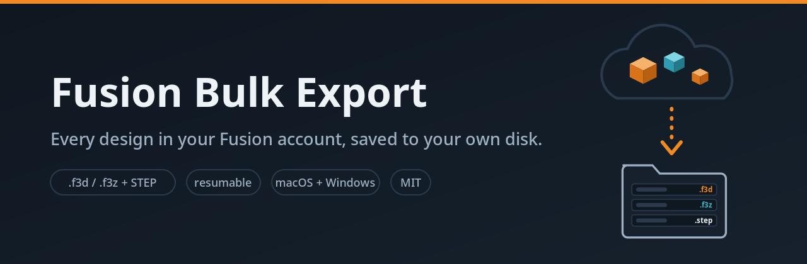
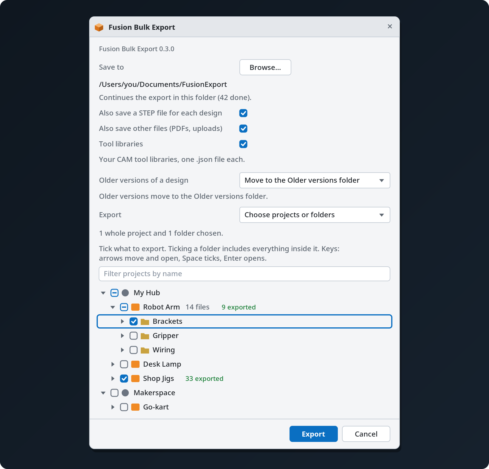

# Fusion Bulk Export



Get all of your Fusion designs out, in one go.

- Saves every design in every hub, project and folder you can access as a Fusion archive (`.f3d`) plus a `.step`, under their real names, in the same project and folder layout.
- Saves the other files too: PDFs, images and uploaded files as they are; drawings as PDF if you ask for them.
- Resumable: run it again on the same folder and it skips what's already done.
- Everything stays on your computer. Nothing in your account is changed.

**Tested on real Fusion** (2706.1.17, macOS) with version 0.2 and a real account, through both the toolbar button and the command line: 59 of 59 designs exported, every archive and STEP file checked, no failures (3.5 minutes, 52 MB); exporting a single chosen folder was checked too. On Windows 11 the button and the command line were tested too: an inventory of a large account and a small trial export, every file checked. If you hit a problem, please [open an issue](../../issues/new/choose) with your Fusion version and the end-of-run counts.

## Quick start

You need Fusion installed and signed in, on macOS or Windows. Nothing else.

**Step 1: Download**
1. Open the [latest release](../../releases/latest).
2. Under **Assets**, click `FusionBulkExport-<version>.zip`.
3. Unzip it. You get a folder named `FusionBulkExport-<version>` with two installers, a `README.txt` and the add-in.

**Step 2: Install and switch it on (once)**
1. In the unzipped folder, double-click the installer for your computer:
   - **macOS:** `Install (macOS).command`. It is not signed, so the first time macOS (Gatekeeper) refuses to open it: right-click it, choose **Open**, then **Open** again. If there is no **Open** button, open **System Settings → Privacy & Security**, scroll down and click **Open Anyway**.
   - **Windows:** `Install (Windows).bat`. If SmartScreen warns you, click **More info**, then **Run anyway**.

   It copies the add-in into Fusion's add-ins folder and changes nothing else. You can delete the download afterwards.
2. In Fusion press **Shift+S** (or **Utilities → Add-Ins → Scripts and Add-Ins**) and open the **Add-Ins** tab.
3. Switch **FusionBulkExport** on (**Run**) and tick **Run on Startup**, so it is there every time Fusion starts.

If **FusionBulkExport** is not in the list, or you would rather not run the installer: move the `FusionBulkExport` folder from the download somewhere it can stay (Documents is fine), click the green **+** in the **Add-Ins** tab, choose that folder, then switch it on as above.

**Step 3: Export**
1. Open the **Utilities** tab and click the orange cube in the **ADD-INS** group (**Fusion Bulk Export**).
2. Check **Save to**. The first time it suggests `Documents/FusionExport`; **Browse…** picks another folder, and the dialog remembers your choice. If the folder already holds an export, the line under it says **Continues the export in this folder**.
3. Choose what to export:
   - **Everything**: every design in every hub and project you can see.
   - **Choose projects or folders**: a tree of your hubs, projects and folders. Click a row to open it, tick a box to include it. A ticked folder includes everything inside it.
4. Leave **Also save other files (PDFs, uploads)** ticked to save them too, or untick it for designs only. Tick **Also export drawings as PDF** only if you need your drawings: Fusion takes minutes to open each one. Both choices are remembered.
5. Click **Export** and wait for the last dialog. It shows the counts and the first failures, and opens the report or the folder for you.

**Fusion can't be used while it exports.** Leave it open and signed in until the last dialog appears; the computer is kept awake meanwhile. **Cancel** is safe: what is finished stays finished. Run it again on the same folder to continue, to retry failures, or to pick up designs added later.

*The pictures below are illustrations drawn from made-up names, not screenshots of a real account.*




### The dialog

- The first line shows the version that is running.
- **Choose projects or folders** opens a tree. Type in the filter box to narrow the projects by name. The keyboard works too: arrow keys move and open, **Space** ticks, **Enter** opens. An opened project or folder shows how many files it holds, and a project that already has files in the chosen folder is marked "N exported".
- If a folder cannot be listed, the tree says so with a **Retry** button.
- The button is always there, also after an export from the command line. Only one export runs at a time.
- While it exports, the progress text says which design (or "file N" for another file) it is on. A drawing says it is opening, which can take minutes.
- If the run gets into trouble (5 designs failing in a row, a full disk, the output folder gone), it pauses and asks: **OK** tries again and carries on, **Cancel** stops.

### Big account? Go one project at a time

If you have hundreds or thousands of designs, start small:

1. Pick **Choose projects or folders** and tick **one** project or folder.
2. Export it and look at the result: open `index.html` in the output folder, open a couple of the `.f3d` files in Fusion and check the counts in the last dialog.
3. Then do the next project, or the rest, into **the same output folder**. Finished designs are checked and skipped, so nothing is done twice.

What to expect: the export starts right away and works folder by folder: it lists a folder, exports what it finds, then moves on, so the first files appear within seconds. The progress dialog shows the project, folder and design it is on, how long it has been running, the average time per design and how many failed. Drawings, if you ticked them, take minutes each. In our small tests a design took about 3.5 seconds, so 1,000 designs would be roughly an hour. **Your time will vary**: large assemblies, many bodies and heavy history take much longer than simple parts, and listing a large project is slow in Fusion itself, so treat these numbers as a rough guide and time your first project.

**Let your AI do it.** If you use an AI agent that can run commands on your computer, paste this into it:

```text
Back up my Autodesk Fusion designs to this computer with Fusion Bulk Export
(https://github.com/cad-lifeboat/fusion-bulk-export). Download the repository and follow its AGENTS.md.
- Start with an inventory and tell me only the counts (hubs, projects, designs).
- If I have hundreds of designs or more, go one project at a time into the same output folder,
  and check each one before the next.
- Never print or repeat my project or design names, never upload, change or delete anything in my
  Fusion account, and ask me before deleting anything on disk.
- Tell me when you need me to sign in or click something in Fusion.
```

It only needs you for signing in and, the first time, switching the add-in on in Fusion.

## What you get

```
FusionExport/
  My Hub/Robot Arm/Brackets/Base plate v3.f3d     the full design: history, sketches, everything
  My Hub/Robot Arm/Brackets/Base plate v3.step    geometry for any other CAD program
  My Hub/Robot Arm/Brackets/Base plate v3.png     the design's thumbnail
  My Hub/Robot Arm/Brackets/Datasheet.pdf         another file, under its own name
  My Hub/Robot Arm/Brackets/Base plate drawing.pdf   a drawing, saved as PDF (when ticked)
  index.html                                      the report: every item, its status and links to its files
  index.csv                                       the same as a table
  manifest.json                                   every item, its status and checksums
  export.log
  export.lock                                     only while an export runs into this folder
```

- **`.f3d`** opens in Fusion with **Upload** or **File → Open → Open from my computer**.
- **`.step`** holds the visible bodies, without history. Most CAD programs open it.
- **Names are the real ones**, in any language. Only characters Windows or macOS cannot store are replaced, and a name is cut at 100 characters (64 on Windows). A short `~1a2b` suffix is added only when two items in one folder would get the same name. There is no limit on how deep the folders go.
- **Windows paths over 260 characters:** deep folders can still make a full path longer than that. Such files are saved, but Explorer and some programs cannot open them; the last dialog and `index.html` say how many. A short output folder such as `C:\FusionExport` avoids it.
- Exported files carry the design's modified date, so sorting by date means something.
- **Other files** (PDFs, images, uploaded STEP files and so on) are saved as they are, under their own names. A newer version of such a file replaces the older one.
- **Drawings** are saved as PDF only when you tick **Also export drawings as PDF** (command line: `--drawings`), because Fusion takes minutes to open each drawing. Otherwise they are listed as skipped, with that reason. Electronics and other Fusion-only file types cannot be exported through Fusion's API: they are listed as skipped, with the reason.
- Only each design's current version is exported, not its older versions. A newer version of a design gets its own files next to the old ones (`v4` beside `v3`).
- **Linked designs:** Fusion's API can only save a design on its own, not as a `.f3z` bundle with the designs it links to. Every linked design is exported in its own right, so nothing is lost, and `manifest.json` lists each design's links under `references`. Re-linking after import is manual. If you need one self-contained `.f3z`, use **File → Export** in Fusion for that design.
- **Broken or out-of-date links:** if a design with links fails, the reason reads "A linked design is missing or cannot be opened (N links)", with Fusion's own message beside it in `index.html` and `index.csv`; open it in Fusion and fix its links. A design whose links point to older versions of other designs is exported as it is, with a note (not a failure), counted in the last dialog, `index.html` and `status`. `inventory.json` marks designs with links (`has_references`, `references_out_of_date`), so you can fix them first. If Fusion cannot read a design's links at all, the design is still exported, with the warning "Links to other designs could not be read; the design itself was exported".
- If you rename or move a design or folder in Fusion, files already exported stay where they are; new exports use the new names.
- **Export folders from version 0.2 or older** keep their short names with a `~hash`: what is already there is not exported again or renamed, and new designs get readable names.
- While an export runs, the folder also holds `manifest.journal` (a quick record of each finished item), a `.staging` folder (Fusion writes there first) and `export.lock` (one export at a time per folder). All are tidied up when the run ends. A second export into the same folder, from another Fusion or the command line, is refused with "Another export is using this folder".

The counts, in the last dialog, in `index.html` and from `autorun.py status`:
- **exported now**: designs written in this run;
- **already up to date**: designs exported before and checked, so left alone;
- **other files saved**: PDFs, uploads and (when ticked) drawings saved in this run;
- **other files already up to date**: other files saved before and checked;
- **skipped**: not saved, with the reason (a file type Fusion cannot export, drawings when they are not ticked, or other files when you chose designs only);
- **failed**: tried twice and did not work; they are tried again next time.

A design whose STEP has no bodies, or fewer solids than Fusion showed, is exported with a **warning**. The `.f3d` is still the complete copy; the warning is in the last dialog and in the report.

`manifest.json`, `index.html`, `index.csv` and the logs contain your project and design names. Keep them private, and don't attach them to issues.

## If something goes wrong

- **A design shows as failed:** run the export again on the same folder. Failed designs are retried, and finished ones are checked and skipped. `index.html` lists failures first, with the reason and what to do.
- **"Open in Fusion with unsaved changes":** save or close that design (or drawing), then run again. A design or drawing you have open without changes is exported as it is and left open.
- **"A linked design is missing or cannot be opened":** open the design in Fusion, fix or remove the broken link, then run again.
- **"Another export is using this folder":** another Fusion or a command-line job is exporting into it. Wait for it to finish, or choose another folder.
- **Many designs fail in a row, or the disk is full:** the export stops itself after 5 designs fail one after another (offline or signed out, usually) or when the disk is full or the output folder is gone. From the button it pauses and asks: **OK** tries again and carries on, **Cancel** stops. Fix the cause, then run again: it carries on where it stopped. It also warns when less than 1 GB is free.
- **Cancel:** finished designs are kept, so run again to continue.
- **Something unexpected:** the dialog says so and saves the details to `errors.log` in the add-in's folder, ready to copy. The details hold no paths or project and design names, so they are safe to paste into an issue; read them once before posting all the same.
- Still stuck? [Open an issue](../../issues/new/choose) with the counts and error messages, with any design names replaced by `X`.
- **Tell us how it went.** If it worked, or mostly worked, [post your numbers](../../discussions/new?category=show-and-tell) (Fusion version, how many designs, how long). Ideas and questions go in [Discussions](../../discussions); issues are for things that are broken.

## How resuming works

Running again on the same folder skips a finished item only if its files are still there
unchanged: same size and modified time, or, if the time differs, the same checksum. Missing
or changed files are made again. A failed design gets two tries per run. Each finished item
is recorded straight away in `manifest.journal`, and `manifest.json` is rewritten every 50
items or 30 seconds and at the end, so stopping or a crash loses at most the item in
progress. Only one export at a time can use a folder (`export.lock`).

## Checking an export

`python3 scripts/autorun.py check <folder>` checks every exported item again, without Fusion:
- every file is still there, with the checksum it had when it was exported;
- the `.f3d` is a readable archive with Fusion's design data, every part of it readable;
- the `.step` has a valid start and end;
- the number of solids in the STEP matches the visible solid bodies Fusion reported.

It prints counts only. A solid-count difference is printed as a NOTE, not a failure: Fusion's
STEP translator occasionally merges or drops a body, and the `.f3d` is the complete copy.
`--names` shows design names. `python3 scripts/verify-export.py <folder>` does the same checks
(it takes `--strict`, which treats solid-count differences as failures, and `--names`). On
Python before 3.14, archive parts compressed with Zstandard are counted as not CRC-checked.

## Command line (for AI agents and scripts)

You don't need this for a big account: the button streams and shows its progress. The
command line is for AI agents and scripts that run the export without clicks. It needs a
download of this repository and Python 3.9 or newer (`python3` on macOS, `py` on Windows).

```sh
python3 scripts/autorun.py inventory ~/FusionExport                     # counts only; opens nothing
python3 scripts/autorun.py export ~/FusionExport --project PROJECT_ID    # one project
python3 scripts/autorun.py export ~/FusionExport --folder PROJECT_ID:Parts/Brackets    # one folder, by names
python3 scripts/autorun.py export ~/FusionExport --folder PROJECT_ID:id=FOLDER_ID      # one folder, by id
python3 scripts/autorun.py export ~/FusionExport                         # everything; rerun to resume
python3 scripts/autorun.py status ~/FusionExport                         # how far it got, counts only
python3 scripts/autorun.py check ~/FusionExport                          # check every exported file
python3 scripts/autorun.py stop ~/FusionExport                           # pause after this design
```

- Project ids, and each file's folder ids, are in `inventory.json`. A folder id also works for a folder whose name contains `/`.
- `--designs-only` leaves the other files out; `--drawings` adds drawings as PDF (minutes each). `--limit N` stops after exporting N designs in this run, for a small trial; designs already up to date and other files do not count.
- `status` prints counts only: the last result, the manifest including items still only in `manifest.journal`, warnings, link problems and out-of-date links.
- The output folder can be anywhere, with a path of any length.
- If Fusion is closed, the command opens it. The add-in must be switched on in Fusion once (Step 2 above); until it is, the command says what to click and keeps waiting.
- If someone is exporting with the button, the command answers that Fusion is busy and exits; run it again later.
- If you stop the command (Ctrl-C) or it times out before Fusion started the job, it withdraws the job and says so, so Fusion does not run it later by itself. A job Fusion already started carries on; use `stop` to pause it.
- `diagnostics <folder>` records which export functions your Fusion build has, for bug reports. `reset` only clears job files left behind by an earlier version.

## Developers

- Tests: `python3 -m unittest discover -s tests` (a simulated Fusion API; no Fusion needed) and `node tests/tree_logic_test.js`. CI runs them on macOS, Windows and Linux.
- Install a checkout into Fusion: `python3 scripts/install.py` (`--uninstall` removes it).
- Release zip: `python3 scripts/package.py` writes `dist/FusionBulkExport-<version>.zip`. `python3 scripts/release.py prepare X.Y.Z` sets the version, moves the changelog's Unreleased section, runs the tests and builds the zip; it prints the publishing commands without running them.
- Pictures: `python3 docs/cards.py` regenerates the banner and social preview, `python3 docs/screens.py` the dialog illustrations (both need `cairosvg` for PNGs; without it they write SVG only).

MIT licensed; see [LICENSE](LICENSE). See also [SECURITY.md](SECURITY.md) and [CONTRIBUTING.md](CONTRIBUTING.md).

---

Not affiliated with or endorsed by Autodesk. Fusion is a trademark of Autodesk, Inc.
